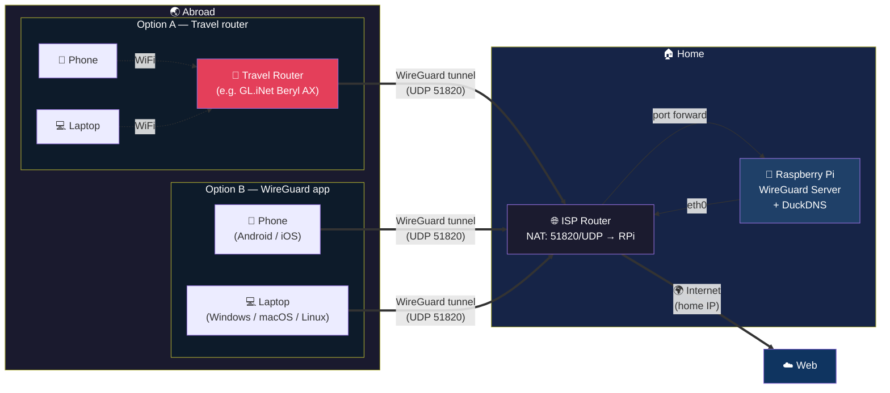

# Raspberry Pi as WireGuard VPN Exit Node

Turn a Raspberry Pi into a WireGuard VPN server so you can browse the internet
from your home IP — even when you're on the other side of the world.

> **Tested on Raspberry Pi 3B** with Raspberry Pi OS Lite 64-bit. Should work on any RPi 3B or newer running the same OS.

**Use case:** You're travelling abroad and some websites, streaming services, or apps
don't work the same way — or at all. This setup lets you route all your traffic through
your home IP. Your devices connect to the RPi via a WireGuard tunnel and everything
works as if you were at home.

## Why Not a Commercial VPN?

Because you're exiting through your own residential IP, not a shared datacenter IP:

- **No CAPTCHAs** — commercial VPNs share IPs across thousands of users, triggering anti-bot checks. Your home IP is clean.
- **No service blocks** — streaming platforms (Netflix, Disney+), banks, and other services actively block known VPN IP ranges. A residential IP isn't flagged.
- **Access your home network** — reach your NAS, cameras, printer, or smart home devices as if you were on your couch.
- **No subscription** — one-time hardware cost, no monthly fees.
- **No third party** — no VPN provider sees your traffic. You own the server, you control the logs.
- **Stable, unique IP** — always the same IP (your ISP box), which helps with services that check geographic consistency.

## Architecture



**How it works:**

1. The RPi sits at home, connected to your ISP router via ethernet
2. [DuckDNS](https://www.duckdns.org) keeps a public DNS name pointing to your home IP (updated every 5 min)
3. Your ISP router forwards port 51820/UDP to the RPi
4. Abroad, your devices connect to the RPi through a WireGuard tunnel — either:
   - **Option A:** via a travel router (e.g. GL.iNet Beryl AX) — all devices behind it are tunnelled automatically
   - **Option B:** via the [WireGuard app](https://www.wireguard.com/install/) installed directly on each device (Android, iOS, Windows, macOS, Linux)
5. All traffic exits through your home IP → you're subject to your home country's internet rules, not the local ones

## Prerequisites

| What | Details |
| ------ | --------- |
| **Raspberry Pi** | 3B or newer, with Raspberry Pi OS Lite 64-bit (fresh install) |
| **Network** | RPi connected via ethernet to your ISP router |
| **DuckDNS account** | Free — sign up at [duckdns.org](https://www.duckdns.org), create a subdomain, grab your token |
| **Router access** | Ability to set up a DHCP static lease + port forwarding (NAT/PAT) |
| **WireGuard client** | Any device or app: travel router, phone, laptop... |

## Quick Start

```bash
# 1. Clone the repo
git clone https://github.com/synthetiqgroup/rpi-wireguard-exit-node.git
cd rpi-wireguard-exit-node

# 2. Edit the configuration section at the top of the script
#    → Set your DuckDNS token, subdomain, and client profile name(s)
nano setup.sh

# 3. Run it (must be root, must be bash)
sudo bash setup.sh
```

The script is fully unattended — zero interactive prompts. It will:

- Install & configure everything (WireGuard, DuckDNS, iptables, unattended-upgrades...)
- Disable IPv6 on the RPi and route it (dead-ended) through the tunnel — prevents IPv6 leaks
- Print each client `.conf` to the terminal — paste it into your WireGuard client
- Run `utils.sh` at the end (full apt upgrade, fail2ban, daily reboot cron) unless `ENABLE_EXTRA_HARDENING=false`

## After the Script

Three manual steps remain:

1. **Router port forwarding** — forward `51820/UDP` to the RPi's local IP
   *(router admin is often at `192.168.1.1` or `192.168.0.1` — check your router's docs)*
   *(if `ENABLE_EXTRA_HARDENING=true`, also forward `2222/TCP` for fail2ban-protected SSH)*

2. **Client config** — paste the generated `.conf` into your WireGuard client
   *(e.g. GL.iNet → VPN → WireGuard Client → Add Profiles → Manually)*

3. **Set the client MTU to 1500** — in your WireGuard client settings, set `MTU = 1500`
   *(e.g. GL.iNet → VPN → WireGuard Client → edit profile → MTU)*. Without this, some apps
   (WhatsApp in particular) fail to connect or send messages even though browsing works.

## Managing the Server

After setup, use `manage.sh` to manage your WireGuard server from the command line:

```bash
# Health check: WireGuard, DuckDNS, public IP, disk (+ fail2ban if installed)...
sudo bash manage.sh status

# List all profiles and their connection status
sudo bash manage.sh list

# Display a profile's .conf + QR code (interactive picker if no name given)
sudo bash manage.sh show
sudo bash manage.sh show phone

# Add one or more profiles
sudo bash manage.sh add phone laptop

# Remove profiles (will ask for confirmation)
sudo bash manage.sh remove phone laptop

# Remove without confirmation
sudo bash manage.sh remove phone -y

# Replace the DuckDNS token and verify it works
sudo bash manage.sh duckdns-token a1b2c3d4-e5f6-7890-abcd-ef1234567890
```

Aliases: `ls` for `list`, `rm` or `del` for `remove`.

## What the Script Does

| Step | Description |
| ------ | ------------- |
| 1 | Refresh package lists (`apt update`) |
| 2 | Create dedicated VPN user with sudo (no password login) |
| 3 | Install dependencies (curl, iptables-persistent, unattended-upgrades) |
| 4 | Configure DuckDNS update script (dynamic DNS) |
| 5 | Enable IP forwarding + disable IPv6 on all interfaces (leak prevention) |
| 6 | Install PiVPN / WireGuard (unattended) |
| 7 | Fix iptables NAT rule (PiVPN bug workaround) + persist rules |
| 8 | Create WireGuard client profile(s), force IPv6 (`::/0`) into the tunnel |
| 9 | Configure logrotate + cap journald at 100 MB |
| 10 | Schedule DuckDNS cron job (every 5 min, optional) |
| 11 | Run `utils.sh` (optional, see below) |

> All configuration is in the top section of `setup.sh` — see the inline comments for details.

## Coexistence with Other Services

If another service on this machine already updates **the same DuckDNS domain**, set `DUCKDNS_CRON=false` in `setup.sh`. The DuckDNS update script is still created (for manual testing via `manage.sh`), but the cron job is skipped.

If you use a **different DuckDNS domain** for this service, leave `DUCKDNS_CRON=true`.

## Preventing IPv6 Leaks

This setup is IPv4-only end to end (WireGuard, DuckDNS, DNS servers, port forwarding). To make sure a client with native IPv6 connectivity can't bypass the tunnel:

- IPv6 is disabled at the kernel level on the RPi, on all interfaces (step 5)
- Each generated client profile routes `::/0` into the tunnel alongside `0.0.0.0/0` (step 8), so IPv6 traffic is dead-ended on the server instead of leaking over the client's local network
- **If you use a travel router (GL.iNet or similar, Option A):** also disable IPv6 on the router's LAN/WAN interfaces. Many travel routers relay a public IPv6 prefix (delegated from the local WiFi/4G WAN) directly to LAN clients via SLAAC — devices then get a native IPv6 address routed straight to the WAN, completely bypassing the WireGuard tunnel. Disabling IPv6 in the router's network settings (GL.iNet UI or LuCI → Network → LAN/WAN) closes this leak. This does not apply to Option B (WireGuard app installed directly on the device).

## Extra Hardening (utils.sh)

`setup.sh` runs `utils.sh` at the very end when `ENABLE_EXTRA_HARDENING=true` (default). It goes beyond strict VPN-exit-node scope:

- Full system upgrade (`apt full-upgrade` + `autoremove`)
- `fail2ban` with progressive SSH banning (1min → 5min → 25min → ... → 24h max, ports 22 and 2222)
- Daily cron: `apt update` at 3:00 AM, reboot at 3:05 AM
- A final reboot (5s delay, Ctrl+C to cancel) to verify everything survives a restart

Set `ENABLE_EXTRA_HARDENING=false` in `setup.sh` to skip `utils.sh` entirely and keep the server strictly VPN-scoped.

## Performance

Your actual speed is limited by the **slowest link** in the chain:

1. **Home ISP** upload speed (e.g. 400 Mbps fiber upload)
2. **Raspberry Pi** WireGuard throughput (see table below)
3. **Remote ISP** speed where you're connecting from
4. **Client device** WireGuard capability (e.g. GL.iNet Beryl AX caps at ~300 Mbps over ethernet)

| RPi model | Max WireGuard throughput   |
| --------- | -------------------------- |
| RPi 3B    | ~85 Mbps (USB2 shared bus) |
| RPi 4     | ~500 Mbps                  |
| RPi 5     | ~900 Mbps                  |

## Troubleshooting

| Problem | Cause | Fix |
| ------- | ----- | --- |
| `syntax error near unexpected token (` | Script was run with `sh` instead of `bash` | Use `sudo bash setup.sh` — arrays require bash |
| DuckDNS returns `KO` | Wrong token or subdomain | Double-check `DUCKDNS_TOKEN` and `DUCKDNS_DOMAIN` at [duckdns.org](https://www.duckdns.org) |
| PiVPN install fails | RPi hostname is too long | Keep hostname under 20 characters (`sudo hostnamectl set-hostname short-name`) |
| `pivpn add` refuses the profile name | Name exceeds 15 characters | WireGuard interface names are limited to 15 chars — use shorter names |
| Two devices share the same `.conf` | Only the last connected device works | Each profile has a unique key pair — **1 profile = 1 device at a time**. Create a separate profile per device. |
| Browsing works but WhatsApp (or other apps) can't connect / send messages | MTU mismatch on the client side | Set `MTU = 1500` in the WireGuard client config (see [After the Script](#after-the-script), step 3) |
| Slow download, fast upload | ISP or mobile carrier throttling UDP | Test on a different network — this is not a tunnel issue |
| WireGuard app says "endpoint domain could not be resolved" but WireGuard is running fine on the RPi | The client's ISP does not resolve `*.duckdns.org` subdomains (common with some mobile carriers abroad) | Replace the domain with the server's public IP in the client config `Endpoint` field. Find the IP with: `https://dns.google/resolve?name=YOUR-SUBDOMAIN.duckdns.org&type=A`. For a permanent fix, set **Private DNS** on the phone to `one.one.one.one` (Android: Settings → Network → Private DNS) so the domain works directly. |

## Disclaimer

This project is provided for **educational and legitimate personal use only**. You are solely responsible for how you use it. Make sure you comply with the laws and regulations of your country and any country you connect from. The author assumes no liability for misuse.

## License

MIT
